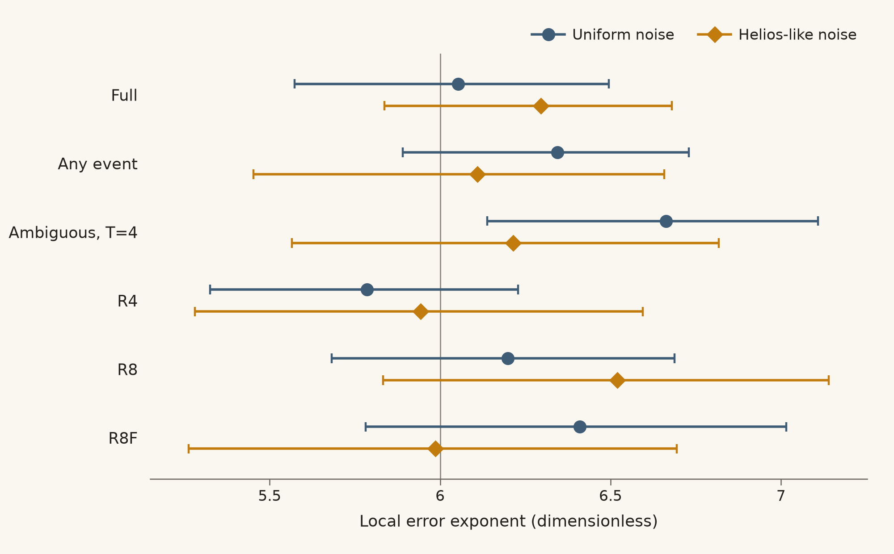
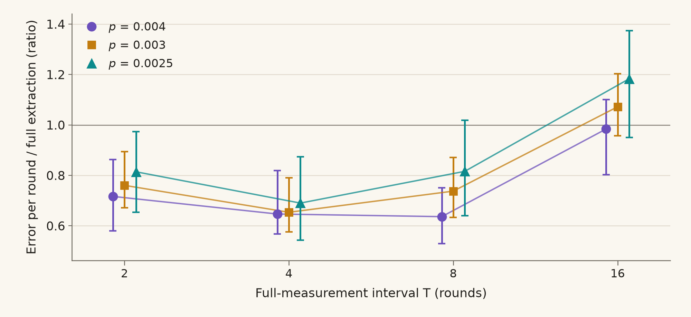

# What supports the result

Circuit bounds, free-order fits, direct sampling and stronger decoding check different parts of the result. The C4 baseline also has a published reference comparison. None supplies a whole-circuit distance bound for R8.

## C4-Helix baseline

Our full-extraction C4-Helix simulation agrees with three points from the authors' [Fig. 11a](https://arxiv.org/abs/2609.03194), under uniform circuit noise at forced-gap threshold $`\gamma=0`$ (no postselection). The compared quantity is block error per round, averaged over X and Z memories. Convert each basis's block failure probability $`p_L`$ over 12 memory rounds to $`1-(1-p_L)^{1/12}`$, then average:

```text
X block failure -> per-round error \
                                    > mean -> Fig. 11a
Z block failure -> per-round error /
```

| $`p`$ | Our estimate | Our conditional 95% interval | Fig. 11a | Ours / reference |
| --- | ---: | --- | ---: | ---: |
| 0.0007 | 8.30e-6 | 6.96e-6 to 1.12e-5 | 7.53e-6 | 1.102 |
| 0.0009 | 1.82e-5 | 1.58e-5 to 2.32e-5 | 1.70e-5 | 1.072 |
| 0.0011 | 3.44e-5 | 3.07e-5 to 4.14e-5 | 3.46e-5 | 0.995 |

All three reference values lie inside our intervals. These are the C4-Helix authors' results; our [reference CSV](results/reference/) reads them from the published figure by gridline calibration and marker-centre matching, with estimated 3% relative reading uncertainty. That uncertainty is separate from our intervals.

The [samples](results/final/c4_repro/) contain 100,000 stratified shots per basis, with 392 X and 113 Z failures across sampled strata. Decoder priors stay at $`p=0.0009`$ for all three evaluations. Observed strata supply 62% to 91% of each basis's estimate; the rest is fitted. Intervals use 200 smoothed parametric bootstrap refits per basis, conditional on the minimum-order-three fit.

This validates our C4 circuits, uniform noise model, decoder and estimator for full extraction. The headline uses the same code, decoder family and estimator, but this check does not validate its adaptive C4 rule (`mode=ase`) or Helios-like model. [The saved comparison](figures/data/c4_uniform.json) is refitted and checked by `./run.sh baseline`; see [REPRODUCE.md](REPRODUCE.md).

## Circuit bounds

All 12 saved decomposition cases exclude undetected logical errors with at most ten faults. Under ideal minimum-fault decoding, distance at least 11 permits correction of up to five faults. The bounds cover these finite memories:

| Saved case names in `results/relaxed_distance/` | Memory rounds after preparation | Basis; outer-check order |
| --- | ---: | --- |
| `X_XZ_full1`, `Z_XZ_full1`, `Z_ZX_full1` | 1 | X or Z; order in name |
| `X_XZ_full8`, `Z_XZ_full8` | 8 | X or Z; X then Z |
| `X_XZ_any4`, `Z_XZ_any4`, `X_XZ_any8` | 4 or 8 | As named; X then Z |
| `X_XZ_P2x4`, `X_XZ_P4x2`, `X_XZ_P8x1` | 8 | X; X then Z |
| `X_XZ_P16x1` | 16 | X; X then Z |

`full` measures everything; `P` allows optional block checks between fixed full measurements; `any` bounds paths with optional block checks and full-outer escalation. These bounds do not cover rotating individual outer checks, arbitrary experiment lengths or logical computation. [The decomposition](docs/methods.md#circuit-distance-by-decomposition) relaxes detector constraints, so its lower bound also applies to the full detector model within that scope.

The [11-fault witness](results/distance/whole__k4cyc__ZX__Z__c1.json), together with `Z_ZX_full1`, establishes distance exactly 11 for that case. [Inner-window checks](results/inner_window/) give distance four on all 276 schedules tested at $`T=2,4,8`$ in both bases. These are finite-window results. Restricted `end__k4cyc__R8_*` searches in [distance/](results/distance/) test only end-of-circuit mechanisms; they cannot prove R8's whole-circuit distance.

## Scaling and decoding



The [free-order fits](figures/data/exponents.csv) support local slopes near six at the sampled fault densities. Their profile-likelihood 95% intervals describe that fit, not asymptotic low-noise behaviour or the imposed order of the headline estimator.

The [constructed preparation errors](results/minimal/constructed.json) contain 20 complementary six-fault pairs; every pair has at least one failure. All 20 selected five-fault subsets are corrected, which is not an exhaustive lower-bound test. [Reduced failure sets](results/minimal/) label six-fault R8 cores as confirmed under Helios-like noise; the smallest such uniform-noise R8 core has seven faults. These labels combine stronger approximate decoding and ILP classifications whose wrapper does not require proven optimality. They are not exact-decoder certificates. Finding a core gives an upper bound on the smallest failing set, not a lower bound.

Stronger Frontier decoding corrects 13 of 153 full-Carbon failures and 6 of 80 R8 failures under Helios-like noise. Under uniform noise the corresponding counts are 20/146 full, 22/169 any-event, 18/123 B4 and 25/155 R8. The headline counts these decoder errors. [The audit](results/redecode/) also tests sampled successes for changes in the opposite direction; stronger approximate decoding is not an exact oracle.

## Independent checks

For full Carbon under uniform noise, [direct sampling](figures/data/direct.json) gives estimated per-logical-qubit errors per round of 7.0e-4 at $`p=0.003`$ and 4.2e-5 at $`p=0.002`$, from 67/12,000 and 8/24,000 failures/shots. Stratified estimates are higher at both points, 1.0e-3 and 8.6e-5, with overlapping intervals. This is a limited check of the estimator, not a validation at the headline noise.

The [basis check](results/summary.json) records 26 Z-memory failures under Helios-like noise against about 104 expected from X fits on the same strata. X is the worse tested basis. The [engine/Stim comparison](results/checks.json) matches all detector/observable signatures on the tested full paths, but its largest relative probability difference is about 0.000467. The detector error models are not numerically identical.

## Why a fixed full-measurement interval

Two three-fault events in different blocks can defeat error correction within one outer-measurement window. In the [selected constructions](results/minimal/constructed.json), full extraction corrects all eight placements; B4 fails four, B8 six, any-event C two and R4 six. These selected failures demonstrate a mechanism, not its probability, and do not test R8.

The window contribution appears at the same $`p^6`$ order as the error floor. Keeping a fixed factor relative to full extraction therefore requires a bounded maximum interval as noise falls; a cap growing as $`1/p^4`$ is unsupported. This is a finite-circuit fault-counting argument, not a universal optimum. [The interval argument](docs/interval_theory.md) states its limits and distinguishes full measurements from rotating checks.



Longer windows lose much of the error-per-round saving, with central ratios below 1.5 through $`T=16`$ at these uniform-noise points. The 95% bootstrap intervals are conditional on the fit; $`T=16`$ uses sixteen memory rounds, while the other points and shared full-extraction baseline use eight.

[intervals.csv](figures/data/intervals.csv) includes all noise points and sampled shares. Without a forced cap, ambiguous-event escalation falls from about 12% of rounds at $`p=0.001`$ to 0.92% at $`p=0.0001`$ in [direct path sampling](figures/data/interval.json). The short-memory results do not establish a long-time lifetime. [REPRODUCE.md](REPRODUCE.md) gives the checks and rerun commands; [references](docs/references.md) credit the code constructions, device inputs and decoder.
