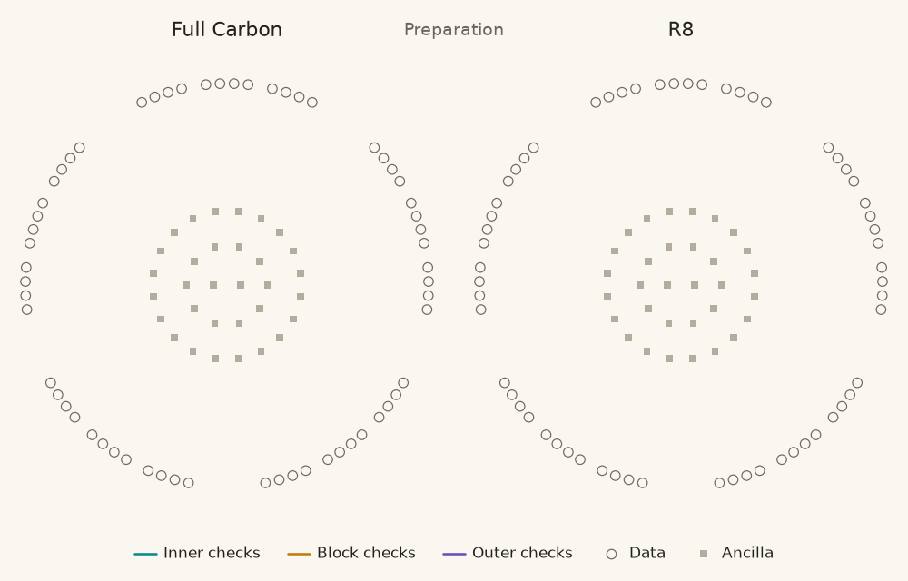
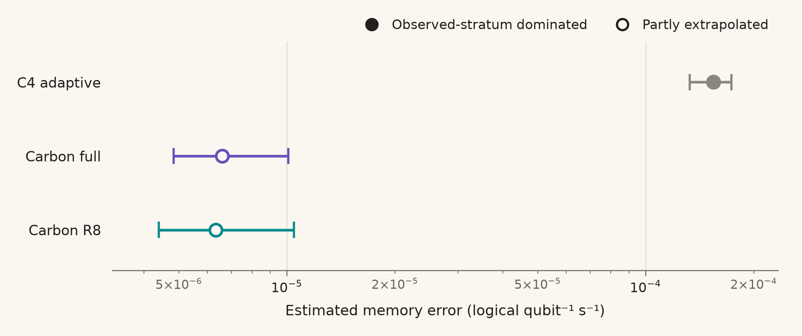
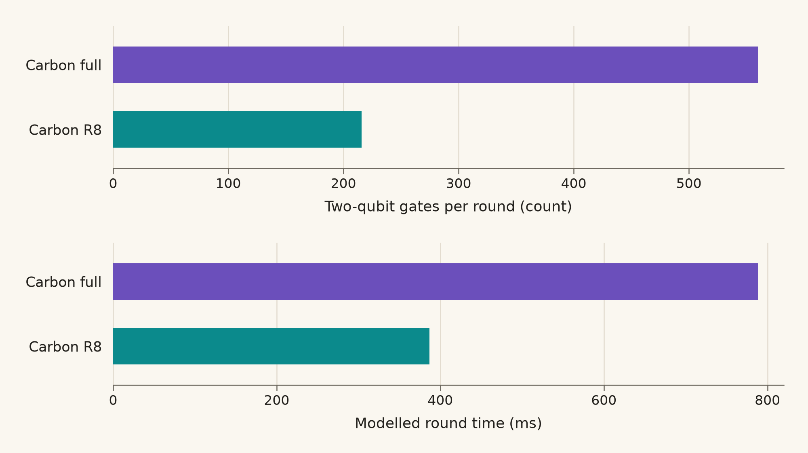

# Carbon-Helix adaptive extraction

Quantum error correction protects stored information by checking qubits for faults; adaptive extraction chooses checks from earlier results. This repository compares Carbon-Helix $`[[60,2,12]]`$ and C4-Helix $`[[20,2,6]]`$ using an adaptive Pauli-frame simulator checked against Stim, Frontier decoding and a noise and timing model of Quantinuum's Helios, a 98-qubit trapped-ion processor.

**Against adaptive C4 at $`p=0.00079`$, the Carbon code gives an estimated 23.4x lower memory error per logical qubit per second with full extraction, or 24.4x lower with R8. R8 saves 61.5% of the two-qubit gates per round and 51.0% of modelled round time versus full Carbon, at comparable estimated error per second.** Carbon uses 92 qubits against C4's 52.

Full extraction beside selected simulated R8 paths, including a return to all outer checks. Ancilla positions follow part-local names, so their apparent proximity to a block and the playback speed have no physical meaning; [all paths](figures/data/r8_paths.json) are included.

Carbon's error estimates are partly extrapolated. Full-extraction C4 [agrees with the authors' Fig. 11a](EVIDENCE.md#c4-helix-baseline) within conditional intervals under uniform noise; this does not validate adaptive C4 or the Helios-like model.

## The gain

At $`p=0.00079`$, the estimated error per logical qubit per second is **6.61e-6 for full Carbon, 6.33e-6 for R8 and 1.55e-4 for adaptive C4**. R8's estimated **24.4x reduction** against adaptive C4 includes the Carbon code's advantage; its gain over full Carbon is the lower extraction cost.

R8's rate interval almost entirely overlaps full Carbon's, so no rate improvement is established. Observed fault strata supply 41.4% of R8's estimate, 38.2% of full Carbon's and 99.1% of C4's; the 95% intervals are conditional on the fit.

R8 averages 215.8 rather than 560 two-qubit gates, and 386.5 rather than 788.4 ms per round. These costs exclude preparation; the error-per-second comparison includes it.

R8 measures inner checks every round, adds weight-6 checks where they detect changes, and measures all outer checks on ambiguity or flags. Otherwise it rotates one outer check. [Results and definitions](RESULTS.md) give the numbers; [the circuits](circuits/) and [porting guide](USE.md) make the schedule reusable.

## Assumptions made

- These are short X-basis memories: one preparation round plus four rounds, encoding two logical qubits. They do not measure logical computation throughput.
- Helios's memory error during a compiled round is unpublished. Doubling the assumed idle-error rate leaves about a 5x advantage for full Carbon and R4; R8 was not tested in that [sensitivity comparison](RESULTS.md#device-assumptions).
- Helios noise and timing are modelled. Compilation, transport and leakage remain untested; block timing also omits some idle noise.
- Sparse Carbon strata assume six-fault scaling. R8 has supporting fits and restricted checks, but no whole-circuit distance bound. [Distance and interval evidence](EVIDENCE.md) also rules out assuming a full-check interval growing as $`1/p^4`$.

## How to use it

Load `circuits/memory_X.stim` or `memory_Z.stim` with `stim.Circuit.from_file`. Run `./run.sh headline` to check the headline, or follow [REPRODUCE.md](REPRODUCE.md) to sample adaptive memories. [USE.md](USE.md) explains how to connect the parts and replace the device model.

Our code, data, figures and text are free to use under [CC0 1.0](LICENSE). The bundled [Frontier decoder](third_party/frontier/) retains its Apache-2.0 licence and notice.
