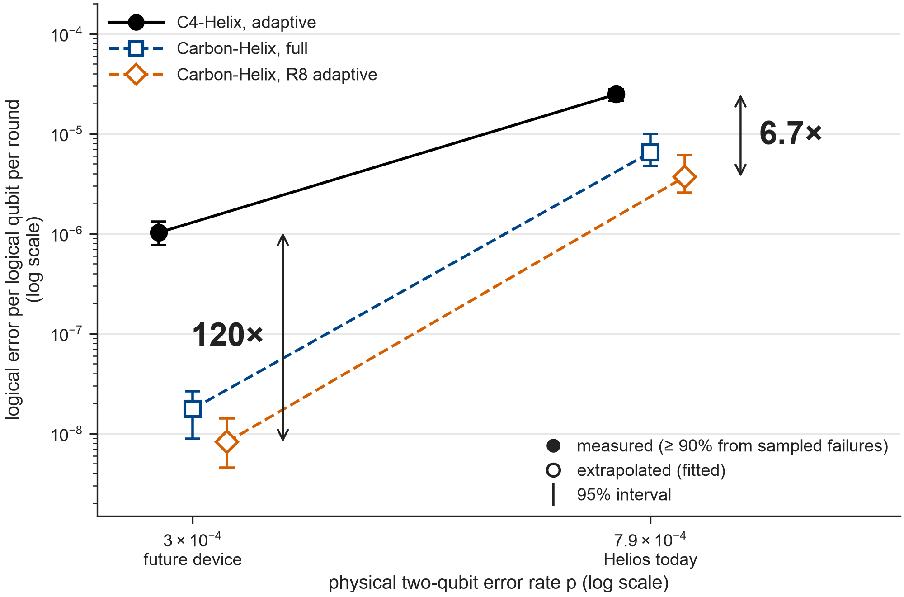
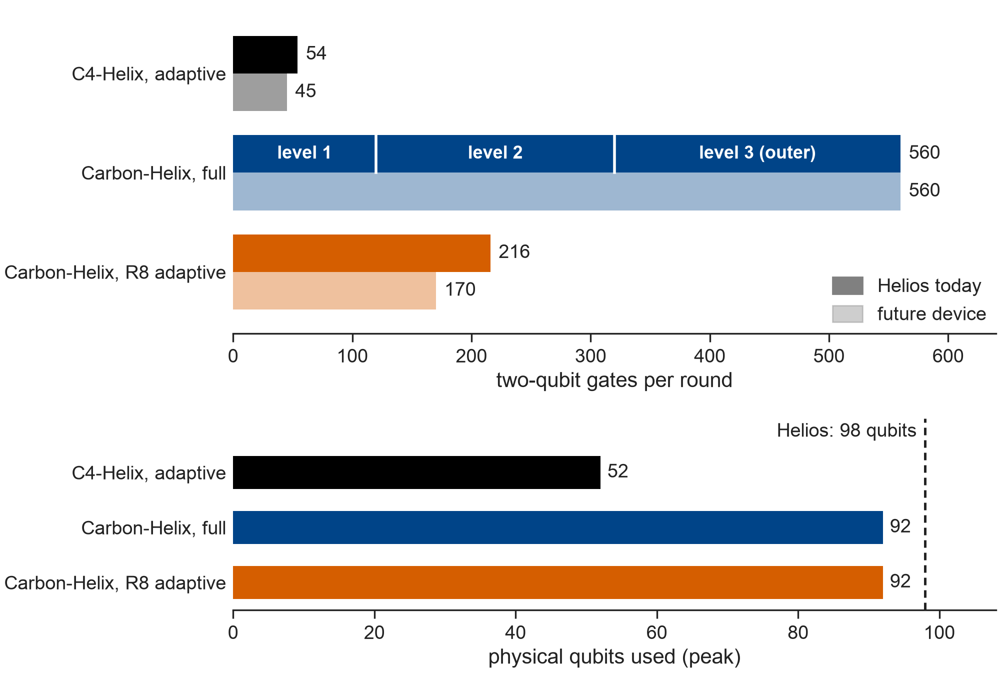
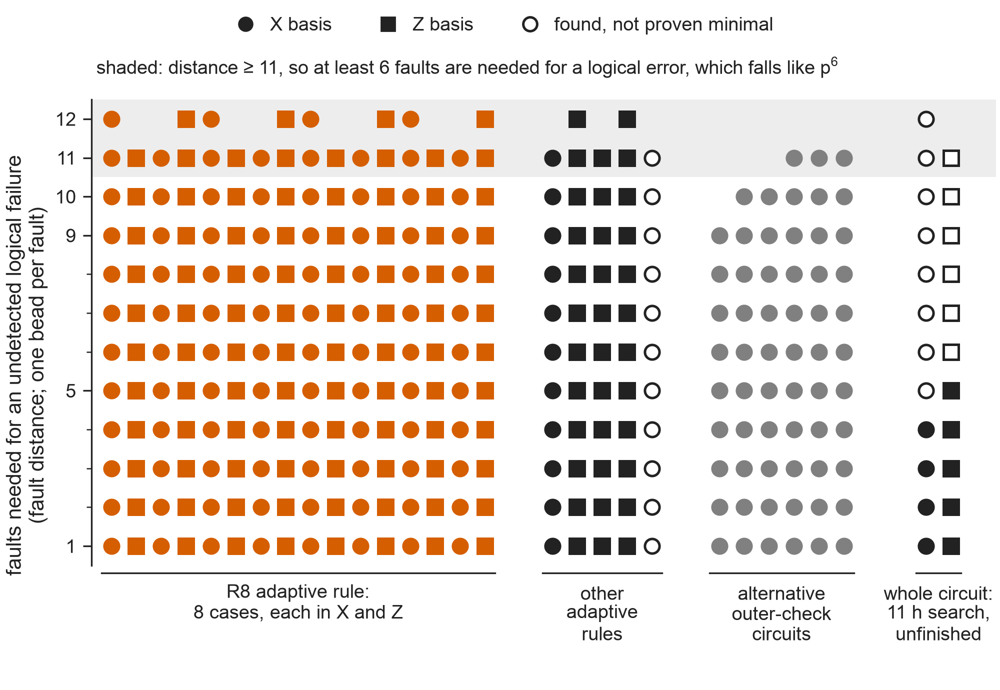
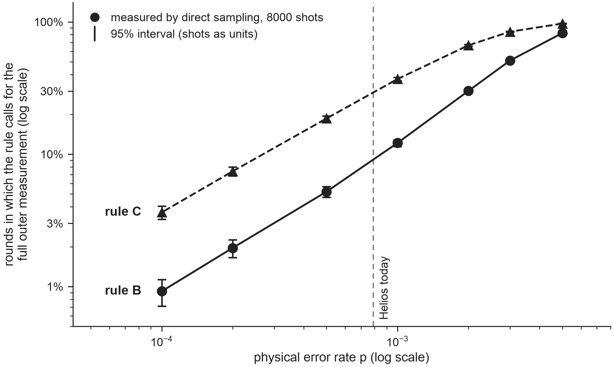
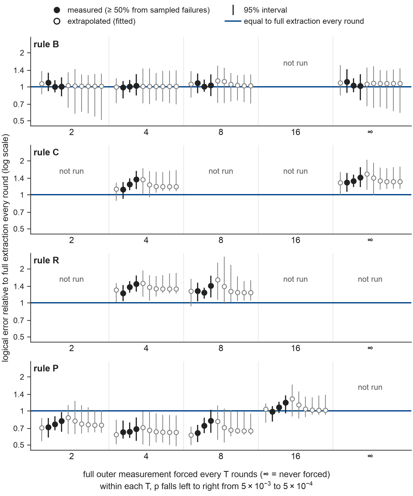

# Carbon-Helix adaptive extraction

**24.4x lower modelled memory error per second than adaptive C4-Helix.** Carbon-Helix R8 fits in 92 qubits and uses 61% fewer two-qubit gates than full Carbon extraction, at a similar estimated error rate per second.

Per round, the advantage over C4 is 6.7x at Helios-like noise. Carbon estimates include extrapolation. These are circuit simulations with modelled times, not hardware results.

<a href="figures/fig1_error.svg"></a>

## Does the extraction circuit fit on Helios?

**Yes: 60 data qubits and 32 reused ancillas, leaving six of the 98 qubits spare.** Full extraction uses 560 two-qubit gates per round. R8 averages 216 at the Helios-like noise point. Hardware compilation and execution remain to be tested.

<a href="figures/fig2_cost.svg"></a>

Use the [circuits and qubit maps](circuits/) to [port the extraction](USE.md).

## Does adaptive extraction keep O(p^6) logical error?

**The tested full, escalating and periodic schedules support six-fault suppression. R8 has supporting fits and restricted checks, but no whole-circuit bound.** Distance at least 11 requires six faults to fail under ideal minimum-fault decoding. Frontier's approximate decoding is checked separately.

<a href="figures/fig3_distance.svg"></a>

The R8 columns cover restricted end-gadget cases. [Whole-circuit decomposition, free-order fits and decoder limits](EVIDENCE.md) give the full scope. The low-noise estimates assume order six and cannot prove it.

## How often must the full code be measured?

**Keep a fixed maximum interval as p falls to stay within a fixed factor of full extraction. An interval proportional to 1/p^4 is not supported.** Two three-fault events can fail within one window, at the same p^6 order as the code's error floor. This does not fix a universal best interval.

Under uniform noise, event triggers call the full measurement less often as p falls:

<a href="figures/fig4_escalation.svg"></a>

Forced intervals have different effects for each rule. B escalates on ambiguity, C on any event, R rotates outer checks, and P uses periodic full checks without escalation. For R, T is the rotation period, rather than a forced full-measurement interval. This study uses uniform noise.

<a href="figures/fig5_schedule.svg"></a>

[Window failures and interval evidence](EVIDENCE.md#why-a-fixed-full-measurement-interval) explain why the short-run B results do not establish that the forced cap can be removed.

## How to use it

Load the complete extraction circuit into your own Stim simulations. From the repository root, run `./run.sh` to install the pinned packages and check the circuits (Python 3.12 or newer and a C++17 compiler are needed). Use `.venv/bin/python` for this example:

```python
import stim

circuit = stim.Circuit.from_file("circuits/memory_X.stim")
detectors, observables = circuit.compile_detector_sampler(seed=7).sample(
    1000, separate_observables=True
)
model = circuit.detector_error_model()
```

Use `memory_Z.stim` for Z memory. For R8, run the simulator below. It chooses which checks to execute from each round's measurements and decodes the path it actually ran:

```sh
.venv/bin/python scripts/simulate.py --shots 128 --out build/r8.json
```

Choose a new output path for each run. To port the extraction into your own stack, start with the [circuit parts and qubit maps](circuits/). [USE.md](USE.md) covers noise settings, adaptive rules, measurement order and feedback.

Anyone may use my code, data, figures and text for anything, including commercial work, with no attribution or other conditions required under the [CC0 1.0 public domain dedication](LICENSE). The bundled Frontier decoder is separate and keeps its [Apache-2.0 licence](third_party/frontier/LICENSE) and [notice](third_party/frontier/NOTICE).

[Reproduction commands and plotted data](figures/README.md#reproduce-the-results) cover the saved results and their limits.
